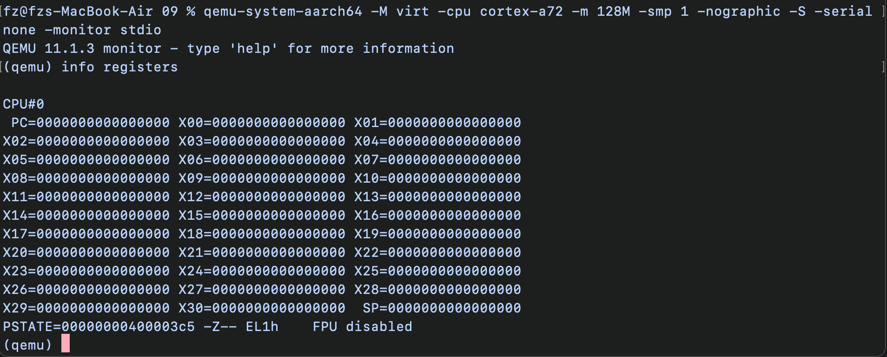
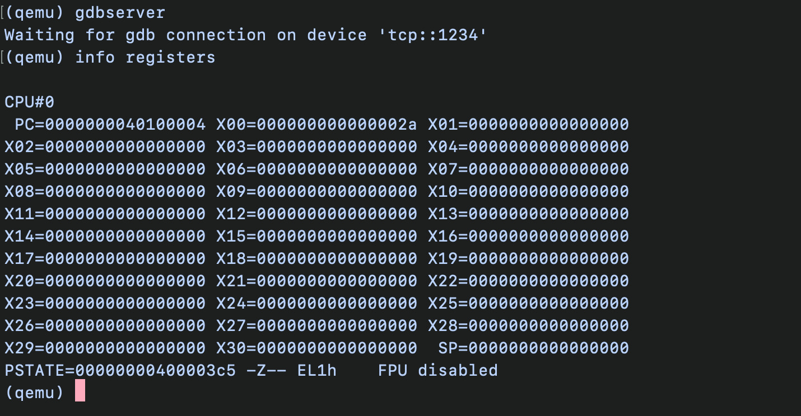
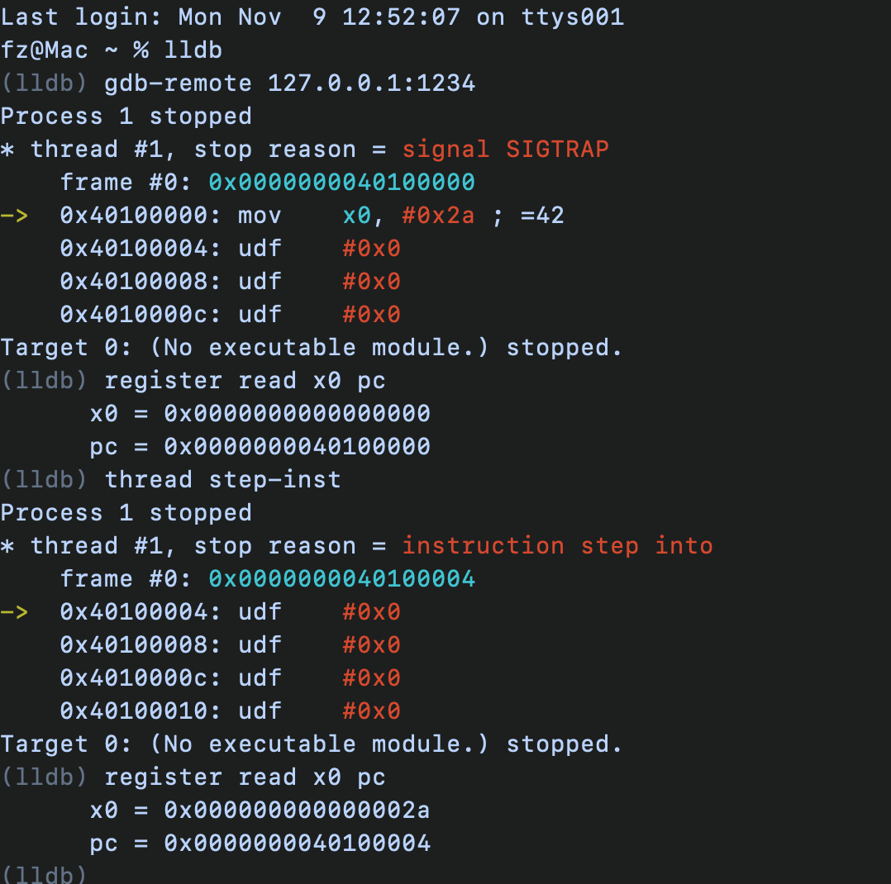

We will run the following command to set up our target device where we will then inspect and execute machine code:

```bash
qemu-system-aarch64 -M virt -cpu cortex-a72 -m 128M -smp 1 -nographic -serial none -S -monitor stdio
```
Note: "-serial none" was fed since without that in nographic, qemu would pass serial to the terminal which would conflict with "-monitor stdio"

When the virtual device started, I typed into QEMU: info registers
Next I saw that as the device started with cpu paused and register state was as follows:


Next I want to inject initial values into PC and a RAM address.

So, as an experiment let's put number 42 in register X0. In assembly that would be:

```asm
MOVZ X0, #42
```

Now ARM64 instruction is:
sf opc fixed hw imm16 Rd

In our case it would be:
1 10 100101 00 0000000000101010 00000

Converting that to hex we would get:
0XD2800540

Therefore, next I will inject that instruction into ram address eg. 0x40100000. That would mean we need to start a new QEMU machine with this:

```bash
qemu-system-aarch64 -M virt -cpu cortex-a72 -m 128M -smp 1 -nographic -serial none -S -monitor stdio \
-device loader,addr=0x40100000,cpu-num=0 -device loader,addr=0x40100000,data=0xD2800540,data-len=4 
```

Following a successful injection of address into PC and data in designated memory address, the machine was ready for executing code. That was done through opening a GDB server and connecting LLDB from another terminal to QEMU and executing a single step. The experiment was a success and screenshots below capture it:




