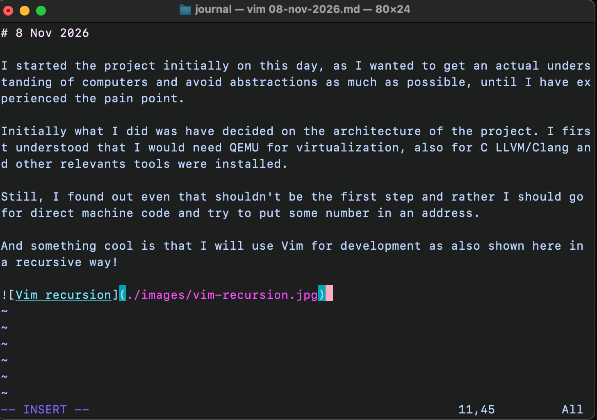

# 8 Nov 2026

I started the project initially on this day, as I wanted to get an actual understanding of computers and avoid abstractions as much as possible, until I have experienced the pain point.

Initially what I did was have decided on the architecture of the project. I first understood that I would need QEMU for virtualization, also for C LLVM/Clang and other relevants tools were installed.

Still, I found out even that shouldn't be the first step and rather I should go for direct machine code and try to put some number in an address.

And something cool is that I will use Vim for development as also shown here in a recursive way!

